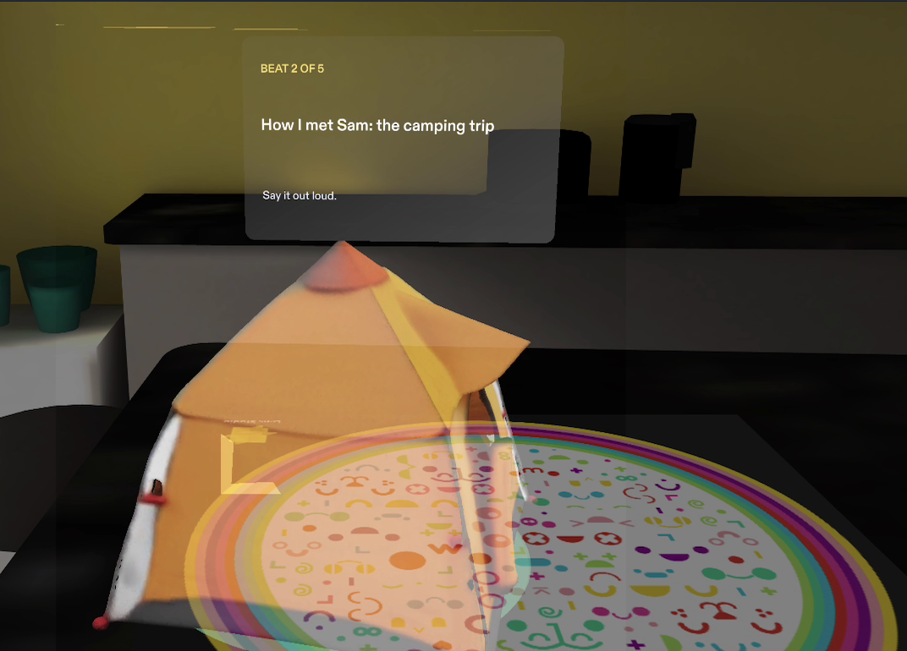

# Walk Your Talk

**Memorize a talk by walking your room.** A memory-palace Lens for SPECS.

Each beat of your talk becomes an odd, vivid object placed on real furniture along a route through your room. You build the palace by pinching glowing spots, rehearse by walking past the objects as each one wakes up and shows its beat, then walk it again from memory and check yourself. The debrief sends you back only for the beats that slipped.

The sample talk is a two-minute wedding toast in five beats:

| Beat | Object | Spot |
|---|---|---|
| Thank everyone for coming | sunflower bouquet | kitchen island |
| How I met Sam: the camping trip | orange tent | end of the island |
| Sam met Alex at the bowling alley | giant bowling pin | armchair by the window |
| Alex taught Sam patience | golden snail | dining chair |
| Raise your glasses to Sam and Alex | champagne flute | dining table |



[Try it in your browser](https://abhinav0905.github.io/walk-your-talk/) · [Watch the demo](https://www.youtube.com/watch?v=iknHR1UDmHI) · [Devpost](https://devpost.com/software/walk-your-talk-memorize-a-talk-by-walking-your-room)

The browser companion runs the Lens's own session logic (`PalaceModel.ts`, compiled by `npm run web:build`) with real Lens Studio preview frames for every step.

## Why glasses

The method of loci works because memories attach to places. On SPECS the places are your real room and the route is your real walk. A speaker's real constraints are hands (a glass, a microphone) and eyes (on the audience, not on notes). Walk Your Talk keeps both free while you rehearse. On a phone, the objects would live on a screen you hold up.

## How it works

1. **Build.** Pinch "Build my palace". Five glowing spots appear on furniture. Pinch the glowing one and that beat's object drops onto it; a gold route of dots joins the spots in order. Only the next spot takes a pinch.
2. **Walk.** Walk up to each object in order (within 90 cm). It hops, turns and shows its beat for a few seconds, just long enough to say it out loud. Out of view, a small chevron and a spatial chime point to the next spot. Can't walk the room? Pinch the next spot instead.
3. **Recall.** The objects hide behind lilac "?" orbs. Say the beat, pinch the orb to check, then pinch **Got it** or **Missed** beside the object.
4. **Debrief.** See your first-pass score and the beats you missed. "Practice the missed beat" builds a route with only those. "Start over" clears the palace.

## Run it

1. Install [Lens Studio 5.23.2](https://ar.snap.com/download/v5-23-2) (or a compatible later version).
2. Open `WalkYourTalk.esproj`.
3. In the Preview panel choose **SPECS 27**, **Interactive Preview** and the **Colorful Home** room. The five spots are placed on that room's furniture.
4. Click to pinch. Walk with WASD, Q/E for down/up, right-drag to look around.

No glasses are needed. The room is simulated; on glasses you would pinch your own furniture.

## Check the logic

```sh
npm install
npm test          # 10 tests on the session model, including a 400-run random-action fuzz
npm run typecheck
```

`Assets/Scripts/PalaceModel.ts` owns every decision and has no Lens Studio dependencies, so it runs under Node. Native checks are separate: 7 LEAF scenarios run in the preview through SIK, one per done criterion plus an IK reachability check. See [devpost/validation](devpost/validation).

## Project layout

```text
Assets/Scripts/
  PalaceModel.ts               session logic (build → walk → recall → debrief → practice)
  WalkYourTalk.ts              controller: camera proximity, pinches, cards, animation, audio
  PalaceCard.ts                compact UIKit card with SIK pill buttons
  PalaceGeometry.ts            MeshBuilder rings, route dots, orbs, pills, arrow
  WalkYourTalkLeafScenario.ts  LEAF scenarios (one per done criterion)
  WalkYourTalkLeafIndex.ts     LEAF index
Assets/Models/                 five objects from Lens Studio's 3D generator
Assets/GeneratedSFX/           six sounds from CLAD's build-sfx engine
devpost/                       design brief, review notes, validation, planning skill
demo-video/                    narration script, preview driver, recorder, editor
tests/                         Node tests for PalaceModel
```

## How it was made

- **Planned** with the Devpost Learn `plan-lens` skill ([challengepost/learn-specs](https://github.com/challengepost/learn-specs)): [devpost/design-brief.md](devpost/design-brief.md).
- **Built** with CLAD (Snap's Lens Studio agent plugin) through the Lens Studio MCP, starting from Snap's Specs Base Template. Spectacles Interaction Kit for every interaction, UIKit BackPlate and Flex layout for the cards.
- **Objects** generated with Lens Studio's 3D generator (GenerateFast3DAssets); lighting turned off on their materials so they stay bright on an additive display.
- **Sounds** synthesized with CLAD's `build-sfx` engine ([tempAssetGen/gen_sfx_walkyourtalk.cjs](tempAssetGen/gen_sfx_walkyourtalk.cjs)).
- **Reviewed** in the preview and changed with design notes: [devpost/after-build-review.md](devpost/after-build-review.md).

## Limits

- Spot positions are authored for Lens Studio's Colorful Home room. On glasses, spots would come from your own surfaces (World Query), which the preview cannot show reliably.
- One built-in talk. Typing or dictating your own talk, and generating its objects live, are next steps.
- Palaces don't persist between sessions yet.
- Comfort, legibility on the real display, real walking and real hand tracking are unproven without glasses. No study has yet tested learning outcomes.

## Credits

New code written during the hackathon. Starts from Snap's official Specs Base Template ([license](SPECS-SAMPLE-LICENSE.md)) and uses the SIK, UIKit, LEAF and AI Preview Agent packages from the Lens Studio Asset Library. Narration in the demo uses Kokoro TTS with the `af_heart` voice: a synthetic voice, not a clone of anyone's voice. English captions were added separately.
